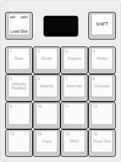

# PATS MP-16 DIY kit

A 16-pad MIDI chord controller you build yourself: 16 MX pads and a Shift key with RGB lighting, a
rotary encoder, a 128x64 OLED, USB MIDI and 3.5 mm TRS MIDI In and Out. By
[PATS audio](https://patsaudio.com/).



This repository holds rev 2 of the kit and the firmware for both revisions:

| | Rev 1 (original kit) | Rev 2 (this repo) |
|---|---|---|
| MCU | Waveshare RP2040-Zero module | RP2040 on the board, 16 MB flash, USB-C |
| Keys | 4x4 matrix + Shift on its own pin | 3x 74HC165 shift registers: every key on its own input, no ghosting |
| Power | LiPo, MCP73831 charger | LiPo with power path (plays while charging), reverse-polarity protection, fuel gauge, 5 V LED supply |
| MIDI | TRS In + Out | TRS In + Out (Type A), Thru selectable in the MIDI menu |
| Expansion | 3-pin header | header with 4 analog inputs, mux select lines, I2C and power for a future pot board |

The rev 1 manual (printing, assembly, how the Chordmaker works):
[PATS MP-16 DIY Kit Manual](https://docs.google.com/document/d/1Koq2ymRy1WZg_HTG9N3nUoAihR9oNaCTS2vanQYqxgY/).

## Firmware

| Sketch | What it does | USB stack |
|---|---|---|
| `MP16_Chordmaker` | The main firmware: each pad plays a chord in the chosen key and scale | Adafruit TinyUSB |
| `MP16_Boilerplate` | Starting point for your own firmware | Adafruit TinyUSB |
| `MP16_YoutubeKeyboard` | The MP-16 as a USB keyboard for YouTube shortcuts | Pico SDK |

### With the Arduino IDE

1. Install the "Raspberry Pi Pico/RP2040/RP2350" boards (Boards Manager; from
   [arduino-pico](https://github.com/earlephilhower/arduino-pico)).
2. Install the libraries Adafruit NeoPixel, Adafruit SSD1306 and Adafruit GFX (Library Manager).
3. **File > Preferences > Sketchbook location**: the `firmware` folder of this repository. The IDE then
   finds the sketches (File > Sketchbook) and the `MP16` library they share.
4. Pick the board and options:

   | | Rev 1 kit | Rev 2 kit |
   |---|---|---|
   | Board | Waveshare RP2040 Zero | Generic RP2040 |
   | Flash Size | 2MB (Sketch: 1536KB, FS: 512KB) | 16MB (Sketch: 2MB, FS: 14MB) |
   | Boot Stage 2 | (default) | W25Q080 QSPI /2 |
   | USB Stack | as in the table above | as in the table above |

   The firmware picks the right pins from the board you choose.
5. Hold **BOOT**, press and release **RESET**, release BOOT: the MP-16 appears as a drive. Click Upload.

### With the command line

```sh
scripts/setup-arduino.sh        # pinned arduino-cli, RP2040 core and libraries
scripts/build-firmware.sh       # every sketch for both boards: build/<rev>/<sketch>/<sketch>.ino.uf2
make -C firmware/test           # tests of the chord engine, MIDI parser and input logic (needs g++)
```

Copy the `.uf2` onto the MP-16's drive (BOOT + RESET as above) to flash it.

## Hardware

The rev 2 schematic and PCB are generated from `hardware/mp16/design.py` with KiCad 7+ and
Freerouting (`hardware/README.md`). The generated KiCad project and the JLCPCB order files are in
`hardware/mp16/`. The original rev 1 EasyEDA project is in `hardware/reference/`.

## Enclosure

`enclosure/stl/`: Top, Midplate, Bottom (closed or open), Switch and OLED standoff, the same for both
revisions. `enclosure/layout.kle.json` is the key layout for
[keyboard-layout-editor.com](http://www.keyboard-layout-editor.com/).

## Working on this with Claude

`CLAUDE.md` describes the layout, commands and rules; cloud sessions install the toolchain through
`.claude/hooks/session-start.sh`. Other firmware for the kit:
[MP-16 Chordmaker V2](https://github.com/giusmarci/MP16-CHORDMAKER-V2) by @giusmarci.

Questions, builds and ideas: [PATS audio on Instagram](https://www.instagram.com/patsaudio/).
